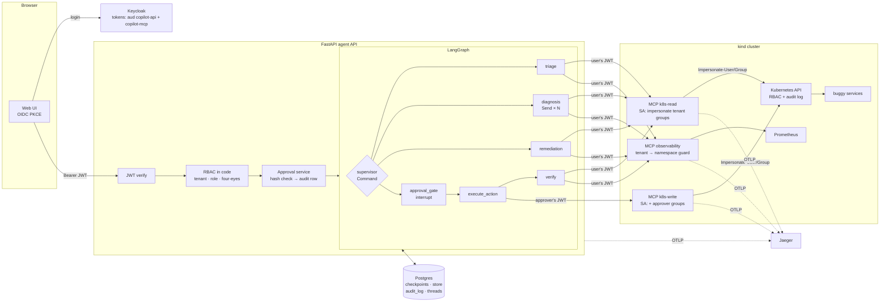

# Incident Copilot (LangGraph)

An SRE incident-response copilot built on LangGraph, with a production-style control plane around it:
authenticated users, user-scoped tool actions (Kubernetes impersonation through MCP servers), role-gated
approval bound to an exact action hash, an append-only hash-chained audit log, durable resume from Postgres,
distributed tracing with PII masking, and an eval suite with pass rates.

A supervisor routes an alert through **triage → diagnosis (parallel hypotheses) → remediation**. The proposed
fix pauses at a single **approval gate** until a human with the `sre-approver` role approves it. It then runs
**as that human** against the cluster and is verified until the workload is stable.

It runs in two modes:
- **mock**: six synthetic incidents served from snapshots (tests, evals, offline demos)
- **live**: a kind cluster with an intentionally buggy service, Prometheus, and three MCP tool servers

Demo walkthrough: [docs/demo.md](docs/demo.md). Build plan and decisions: [plan.md](plan.md).

## Architecture



### LangGraph features used

| Feature | Where |
|---|---|
| `StateGraph`, compiled subgraphs as nodes, input/output schemas | [graph/agents.py](src/copilot/graph/agents.py), [graph/build.py](src/copilot/graph/build.py) |
| Supervisor routing with `Command(goto=...)` | [graph/supervisor.py](src/copilot/graph/supervisor.py) |
| `Send` fan-out: one investigator subgraph per hypothesis, merged by a reducer | `build_diagnosis` in [graph/agents.py](src/copilot/graph/agents.py) |
| `interrupt()` + `Command(resume=...)` approval | [graph/gate.py](src/copilot/graph/gate.py), [approval/service.py](src/copilot/approval/service.py) |
| `AsyncPostgresSaver`, `durability="sync"`, resume after crash and after restart | [db.py](src/copilot/db.py), [runner.py](src/copilot/runner.py) |
| Time travel: state history, replay and fork from a checkpoint | [scripts/history.py](scripts/history.py), `GET /api/incidents/{id}/history` |
| `RetryPolicy` on tool nodes (transient errors) and LLM nodes (API/parse errors) | [graph/common.py](src/copilot/graph/common.py) |
| Streaming `custom` + `updates` + `messages` with `subgraphs=True` | [runner.py](src/copilot/runner.py) |
| `Store` long-term memory (past incidents, runbooks), tenant-namespaced | [memory/store.py](src/copilot/memory/store.py) |
| Runtime `context_schema` + `ToolRuntime`: identity and backends the LLM cannot touch | [context.py](src/copilot/context.py), [tools/read_tools.py](src/copilot/tools/read_tools.py) |
| `ToolNode` `awrap_tool_call` for tool-call recording and UI events | `make_tool_node` in [graph/common.py](src/copilot/graph/common.py) |
| MCP tools via `langchain-mcp-adapters` (streamable HTTP, per-user headers) | [tools/mcp_backend.py](src/copilot/tools/mcp_backend.py) |

## Security model

The LLM decides *what is true* (root cause, which fix). Code decides *what is allowed*, and Kubernetes enforces
*what is possible*.

**User → agent**
- Keycloak issues RS256 JWTs. The API verifies signature (JWKS), issuer, audience `copilot-api`, expiry and `sub`.
  The tenant comes from a `tenant` claim (group attribute), with the `/tenants/<name>` group path as a fallback.
- Identity never comes from the model or the request body. Tenant and requester are written into graph state from
  the verified token. The acting human (and their token) travels in LangGraph's runtime context.
- RBAC in plain Python, before LangGraph is touched ([auth/rbac.py](src/copilot/auth/rbac.py)): same tenant (other
  tenants get `404`, so ids can't be probed), `sre-approver` role, and a four-eyes rule (no approving your own
  incident).

**Approval**
- Every write goes through one gate node. Risk is classified in code ([tools/write_tools.py](src/copilot/tools/write_tools.py)):
  any write in `*-prod`, any non-allowlisted tool, and scaling to zero need a human. Low-risk actions are
  auto-approved by policy and still audited.
- The interrupt carries `sha256(action, thread, tenant)`. The approval service rejects a decision for any other hash
  (`409`) and the gate checks it again on resume.
- `execute_action` refuses to run without an `approved` audit row for exactly that hash, and skips if an `executed`
  row exists, so replays never execute twice.

**Agent → cluster (user-scoped tools)**
- The agent forwards the acting human's token to the MCP servers: the requester's while investigating, the
  approver's when executing. Each server verifies it (audience `copilot-mcp`) and calls Kubernetes with
  `Impersonate-User: kc:<user>` and `Impersonate-Group: copilot:tenant:<t>` (plus `copilot:approvers:<t>` on the
  write server, only for approvers).
- The servers' ServiceAccounts can do nothing except impersonate those names (`resourceNames`). The read server
  cannot impersonate approver groups, so even a compromised read server cannot write. Kubernetes RBAC binds read
  access per tenant namespace and write access to the tenant's approver group
  ([infra/kind/manifests/10-rbac.yaml](infra/kind/manifests/10-rbac.yaml)).
- Prometheus has no per-tenant authorization, so the observability server only builds PromQL from a fixed catalog
  and only for the caller's tenant namespaces.
- The Kubernetes audit log records both the ServiceAccount and the impersonated human
  ([scripts/k8s_audit.py](scripts/k8s_audit.py)). Every write also stamps a change cause naming the approver.

**Audit and tracing**
- Append-only, hash-chained `audit_log` ([infra/postgres/schema.sql](infra/postgres/schema.sql)). The app role has
  `UPDATE/DELETE/TRUNCATE` revoked and a trigger blocks them even for the owner. Partial unique indexes allow one
  decision and one execution per action (also the double-click guard). Rows carry the trace id.
- OpenTelemetry spans for API requests, runs, graph nodes, LLM calls (with token usage), tool calls, MCP tools and
  Kubernetes calls, joined into one trace through `traceparent`. Spans carry tenant and Keycloak `sub`, never
  usernames. A redacting exporter masks emails, JWTs, bearer tokens and secret-looking values. LangSmith traces go
  through an anonymizer with the same rules ([observability/tracing.py](src/copilot/observability/tracing.py)).

Known simplifications: MCP servers receive the user's own access token (with an extra audience) rather than a
per-call token from an RFC 8693 token exchange; the dev realm has a password-grant client for scripts; secrets are
plain env values in the compose file.

## Run it

Requirements: Docker Desktop, Python 3.13, [uv](https://docs.astral.sh/uv/), a DeepSeek API key in `.env` (see
[.env.example](.env.example)). For live mode also [kind](https://kind.sigs.k8s.io/) and kubectl.

```powershell
uv sync
docker compose -f infra/docker-compose.yml up -d --build --wait     # Postgres, Keycloak, Jaeger, API (mock mode)
```

Open http://localhost:8000. Demo users (password = username):

| user | tenant | roles | can |
|---|---|---|---|
| alice | acme | sre | start and view incidents |
| bob | acme | sre, sre-approver | approve alice's incidents |
| carol | globex | sre, sre-approver | sees nothing from acme |

### Live mode (kind + MCP)

```powershell
.\scripts\kind_up.ps1                      # cluster, images, RBAC, Prometheus, MCP servers, buggy releases
$env:COPILOT_TOOL_BACKEND = "mcp"
docker compose -f infra/docker-compose.yml up -d --wait api
```

The UI now offers the live incidents (`checkout-api` OOMKilled loop, `notification-svc` bad config). Jaeger:
http://localhost:16686. Prometheus: http://localhost:30090. Fresh bugs for another run: `.\scripts\kind_up.ps1 -Reset`.
Tear down: `.\scripts\kind_down.ps1`.

### Without the browser

```powershell
uv run python scripts/smoke_e2e.py                                   # real Keycloak + LLM; checks every RBAC path
uv run python scripts/smoke_e2e.py --scenario live_bad_config_notification   # same, against the cluster
uv run python scripts/run_incident.py --scenario live_oom_checkout   # terminal run on the cluster as alice/bob
uv run python scripts/run_incident.py --durable --crash-after diagnosis      # then --durable --thread-id <id>
uv run python scripts/run_incident.py --flaky 1                      # transient tool faults, retried
uv run python scripts/history.py --thread-id <id>                    # checkpoints; --replay / --fork
uv run python scripts/k8s_audit.py --writes                          # who changed the cluster, as whom
```

## Tests and evals

```powershell
uv run pytest                                  # deterministic: unit, API, MCP, tracing, Postgres integration
uv run python scripts/run_evals.py --runs 3    # LLM evals on mocked tools -> eval-results/report.md
```

- **Deterministic tests** (no LLM; scripted fake model): the approval gate (hash mismatch, missing audit row,
  double decision, replay without double execution, auto-approval), RBAC (cross-tenant 404, role 403, four-eyes),
  JWT validation, audit chain tampering, Postgres privileges and trigger, resume after crash and restart, SSE,
  MCP identity mapping and token audience, Kubernetes formatting (secret env values hidden), the metrics tenant
  guard, write patches, verify's stability rule, span structure and PII redaction.
- **Evals** run six synthetic incidents ([scenarios/](scenarios/)) N times each against the real model: OOMKilled
  loop, downstream CPU saturation, database scaled to zero, bad env var, missing image tag, and a false alarm that
  must produce no action. Graded on root-cause category, action (tool and target), verified fix, and trajectory
  (required tools, tool-call budget, no execution without a prior approval).

### Measured results

**Mock evals**: `deepseek/deepseek-flash`, 3 runs per scenario, 2026-11-21 15:36 UTC, approvals automatic.

| scenario | pass | median tool calls | median seconds |
|---|---|---|---|
| oomkilled_loop | 3/3 | 32 | 69.2 |
| high_5xx_latency | 3/3 | 45 | 72.3 |
| db_unreachable | 3/3 | 37 | 55.0 |
| bad_env_var | 3/3 | 31 | 54.7 |
| bad_image_tag | 3/3 | 33 | 85.3 |
| false_alarm_memory | 3/3 | 7 | 17.9 |

Caveats: 18 runs is a small sample, and the synthetic scenarios have clear signals. A perfect score shows the
pipeline works end to end, not that the copilot is reliable on messy real incidents. Harder scenarios (red
herrings, two simultaneous faults, misleading alerts) are the next step to make the evals discriminative.

**Live runs on the kind cluster** (single runs on 2026-11-21, `deepseek/deepseek-flash`, so treat as examples
rather than benchmarks):

| incident | proposed fix | outcome | wall time |
|---|---|---|---|
| checkout-api OOMKilled loop (CLI) | rollback to revision 1, executed as `kc:bob` | resolved, stable 45 s | 2 m 22 s |
| notification-svc bad `SMTP_PORT` (API) | `set_env SMTP_PORT=587`, executed as `kc:bob` | resolved | 2 m 00 s |

The investigation trace of the second run had 23 LLM calls with 86,857 input and 15,168 output tokens.

## Repository layout

```
src/copilot/
  graph/          state, prompts, subgraphs (triage/diagnosis/remediation), gate, supervisor, build
  tools/          read tools, write-action specs + risk policy, ToolBackend, scenario mock, MCP backend
  approval/       action hashing, audit log (in-memory + Postgres), approval service
  auth/           JWT verification, RBAC rules
  api/            FastAPI app, run manager (background runs + SSE), static UI
  memory/         Store helpers (incidents, runbooks)
  observability/  OTel setup, graph span handler, PII redaction, LangSmith masking
  evals/          eval harness and grading
mcp_servers/      k8s-read, k8s-write, observability MCP servers (own image)
buggy_service/    the intentionally broken microservice
scenarios/        synthetic (mock) and live incident definitions
runbooks/         team runbooks loaded into the Store
infra/            docker-compose, Keycloak realm, Postgres schema, API Dockerfile, kind manifests
scripts/          CLI runner, smoke test, migrations, history, evals, kind up/down, k8s audit
docs/             demo script
tests/            unit, integration (Postgres), evals (LLM)
```
